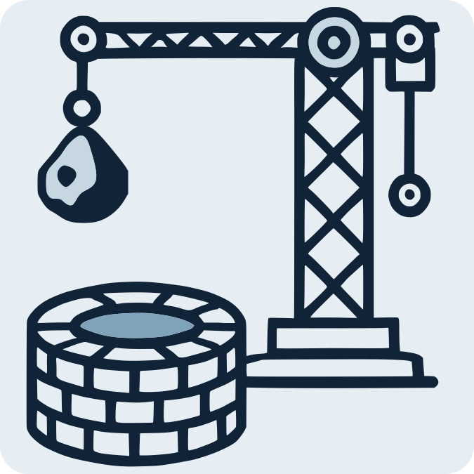

# Crane



## Menu

- [Rationale](#rationale)
- [Project Layout](#project-layout)
- [Installation](#installation)
  - [Building and Testing](#building-and-testing)
- [Usage](#usage)
- [Maintainers](#maintainers)
- [Contributions](#contributions)
- [License](#license)
- [Code of Conduct](#code-of-conduct)

## Rationale

This project provides extraction of [Rocq](https://rocq-prover.org/) (formerly known as Coq) code to C++ code, implemented as a Rocq plugin. It extracts Rocq into valid, performant, and memory-safe, modern C++ code. The generated code does not need a separate runtime system, relying instead on `shared_ptr` for memory management.

The project is a fork of the Rocq-to-OCaml extraction that comes built-in with Rocq.

> [!WARNING]
> Crane is under active development. While many features are functional, parts of the extraction pipeline are still experimental, and you may encounter incomplete features or unexpected behavior. Please report issues on the [GitHub tracker](https://github.com/bloomberg/crane/issues).

## Project Layout

```
crane/
├── src/              OCaml plugin sources, one directory per IR and pipeline stage
├── theories/         Rocq theories: plugin loader, type mappings, monads, C++ runtime headers
├── tests/            Rocq/C++ test pairs
│   ├── basics/       Traditional functional programs
│   ├── monadic/      Effectful examples (IO, STM, threads)
│   ├── regression/   Regression tests for previously fixed bugs
│   └── wip/          Work-in-progress tests for known issues
├── unit_tests/       OCaml unit tests, including the pass-order golden file
├── scripts/          Build and test helper scripts
├── benchmarks/       Benchmark programs
├── libraries/        Example libraries (see below)
└── docs/             Documentation (see docs/README.md)
```

### Example libraries

- [`theories/Libraries/ParseALot`](theories/Libraries/ParseALot) — a verified,
  end-to-end lexing-and-parsing pipeline (Verbatim++ lexer + CoStar++ parser)
  extracted to C++, building as the `Crane.Libraries.ParseALot` theory. See its
  [`PROVENANCE.md`](theories/Libraries/ParseALot/PROVENANCE.md).
- [`libraries/parse-a-lot-bench`](libraries/parse-a-lot-bench) — a self-contained
  benchmark harness for that library (OCaml/C++/reference runners). It is
  excluded from the crane build (`data_only_dirs`) and depends on packages and a
  corpus that crane does not ship; build it standalone per its
  [`README.md`](libraries/parse-a-lot-bench/README.md).

## Installation

Crane needs OCaml 5.4 (5.4.1 or a later 5.4 release) and Rocq 9.1.0. With [opam](https://opam.ocaml.org/), create a switch for them (flambda is recommended, and CI uses it), point your shell at it, and install the dependencies:

```bash
opam switch create crane-flambda --packages ocaml-variants.5.4.1+options,ocaml-option-flambda \
  --repos rocq-released=https://rocq-prover.org/opam/released,coq-released=https://coq.inria.fr/opam/released,default
eval $(opam env --switch=crane-flambda --set-switch)
opam install rocq-runtime.9.1.0 rocq-core.9.1.0 coq.9.1.0
opam install . --deps-only
```

`opam install . --deps-only` installs into whichever switch your shell is using; it does not change the OCaml or Rocq version. If the build reports errors such as `Unbound module Mod_declarations`, your shell is still on an older switch: run `eval $(opam env)` (or open a new terminal) after switching. See [Getting Started](docs/Getting-Started.md) for more. You can then build and install the project by running

```bash
make build && make install
```

Or using dune directly:

```bash
dune build -p rocq-crane && dune install
```

You will also need [Clang](https://clang.llvm.org/) 22 or higher (the generated code is C++26, `-std=c++2c`) to run the tests.

### Building and Testing

The Makefile provides convenient build commands:

- `make build` - Build only the plugin and theories (recommended for development, fast)
- `make install` - Install the plugin
- `make extract` - Build the plugin and extract all of the tests (without compiling the generated code)
- `make test` - Build and run all tests with a summary of passed/failed tests
- `make check-headers` - Compile every generated header on its own
- `make clean` - Clean all build and test artifacts
- `make help` - Show all available commands, including variants for running a single test or folder

Generated files (such as `list.h` and `list.cpp` for `List.v`) are written next to their tests in the `tests` directory.

**Test expectations:** All tests in `basics/`, `monadic/`, and `regression/` are expected to pass. Failures in `wip/` tests are expected and can be ignored unless you are specifically working on fixing one of them. Note that `monadic/skiplist` is nondeterministic, so its occasional failures can be ignored if you haven't changed related files.

For typical development, use `make build` to quickly rebuild after changes to `src/` or `theories/`, then `make test` to verify your changes work correctly.

If you prefer to use dune directly:

```bash
# Build plugin and theories only
dune build src && dune build theories

# Build everything including tests
dune build

# Run tests (builds them first if needed)
dune runtest
```
Tests are **not** built by `make build` to keep development builds fast—use `make test` or `dune runtest` to build and run them.

A few tests (those ending in `_bde`) use [Bloomberg's BDE library](https://github.com/bloomberg/bde) through Crane's optional BDE mappings; without BDE installed they fail with "file not found", which can be ignored (set `BDE_PREFIX` if BDE is installed somewhere Crane does not find it). The `Crane Benchmark` command needs [hyperfine](https://github.com/sharkdp/hyperfine).

## Usage

Once you write your Rocq program, say `Example.v`, you can extract to C++:

```coq
From Crane Require Import Extraction Mapping.Std.

Module Foo.

Fixpoint fac n :=
  match n with
  | 0 | 1 => 1
  | S n' => n * fac n'
  end.

End Foo.

Crane Extraction "Foo" Foo.
```

Mappings activate on `Import`; a bare `Require` of a mapping file loads it without using it.

(You can also extract a single function if you do not want to extract an entire module, which will just extract the function with all of its dependencies as opposed to this which extracts all the definitions in the module [and their dependencies].)

Now run:

```bash
rocq compile Example.v && clang++ -c -std=c++2c -I<crane>/theories/cpp Foo.cpp -o Foo.o
```

This command creates `Foo.h` and `Foo.cpp` files from the Rocq file, and then compiles the C++ to the object file `Foo.o` with Clang, ready to be linked to your own C++ file containing a `main` function for execution. The `-I` points at Crane's header-only runtime (`theories/cpp` in the checkout), which generated code includes; see [Getting Started](docs/Getting-Started.md).

## Maintainers

- Joomy Korkut — <jkorkut@bloomberg.net>
- Matthew Weaver — <mweaver89@bloomberg.net>

## Contributions

We :heart: contributions.

If you've had a good experience with this project or wish to contribute improvements, we'd love to hear from you. Feel free to submit [issue reports or suggestions](https://github.com/bloomberg/crane/issues), making sure to select an appropriate issue template.

Before opening a [pull request](https://github.com/bloomberg/crane/pulls), please review our [contribution guidelines](https://github.com/bloomberg/.github/blob/master/CONTRIBUTING.md).

## License

Please refer to the [LICENSE](/LICENSE) file for detailed information.

## Code of Conduct

This project has adopted a [Code of Conduct](https://github.com/bloomberg/.github/blob/master/CODE_OF_CONDUCT.md).
If you have any concerns about the code or behavior which you have experienced in the project, please
contact us at [opensource@bloomberg.net](mailto:opensource@bloomberg.net).
